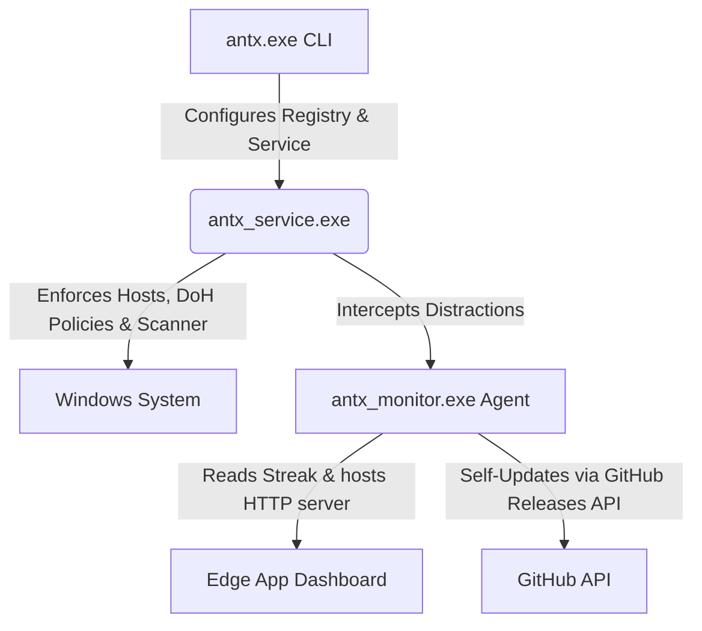

# 🛡️ Antx Blocker

*[Leia em Português](README.pt-br.md)*

[](https://github.com/bielsk1/antx/releases)
[](https://github.com/bielsk1/antx)
[](https://github.com/bielsk1/antx)
[](https://github.com/bielsk1/antx/blob/main/LICENSE)

Antx is an ultra-resilient, high-performance, native C++ focus blocker and anti-procrastination shield for Windows. Built to end digital distraction at the root level, it actively prevents self-sabotage by combining kernel-like local services, browser-level policy enforcement, and a beautiful, dopamine-free minimalist victory dashboard.

Unlike simple browser extensions that can be bypassed in two clicks, **Antx is engineered to be near-impossible to bypass** without entering the strict password you set for yourself.

---

## 🌟 Key Features

*   **🛡️ Active Tamper Proofing:** Employs a native Windows Service (`antx_service.exe`) running under the `LocalSystem` account with aggressive auto-recovery watchdogs.
*   **🚫 Native Window & Process Scanner:** Scans active process windows every 400ms. Instantly terminates browsers (Chrome, Edge, Firefox, Opera, Brave, Vivaldi) attempting to access pre-configured distraction keywords.
*   **🔒 Secure Anti-Uninstall Lock:** Prevents uninstallation or manual stops of the blocker service. Stopping the blocker requires a secure SHA-256 hashed password stored safely in the Windows Registry.
*   **⚙️ Browser DNS-over-HTTPS (DoH) Lock:** Forcefully overrides browser registries to disable DoH at the OS and browser levels, guaranteeing local `hosts` file redirection is strictly followed.
*   **📊 Ultra-Minimal Victory Dashboard:** A sleek, glassmorphic dark-mode interface built using Tailwind CSS that displays only your continuous focus streak (Days, Hours, Minutes, Seconds) and a blocked attempt counter. No distracting sidebars or menus.
*   **🔄 Silent Auto-Updater:** The background agent checks the GitHub Releases API every 12 hours. If a new release is pushed, it silently downloads the update and applies it seamlessly without interrupting your workflow.

---

## 🏗️ Architecture: The 3-Part Shield

Antx is divided into three highly specialized components that communicate seamlessly:



1.  **`antx.exe` (CLI Controller):** The administrative command-line tool used to install, configure registry passwords, generate random high-security bypass-prevention keys, or securely uninstall the blocker.
2.  **`antx_service.exe` (The Guard):** A background Windows Service that constantly monitors hosts-file integrity, overrides system and browser DoH protocols, and acts as the low-level scanner that terminates forbidden windows.
3.  **`antx_monitor.exe` (Dashboard & Update Agent):** A lightweight background agent that runs inside the system tray. It hosts a local lightweight Winsock HTTP server to display your minimalist Focus Streak and handles silent auto-updates.

---

## 🚀 Getting Started & Installation

### Option 1: Quick Install (Recommended)
Simply go to the [Releases](https://github.com/bielsk1/antx/releases) page, download the latest `Antx_Setup.exe` installer, and run it. The installer will package all dependencies, create your desktop/system tray shortcuts, and activate the protection automatically.

### Option 2: Static Compilation from Source
If you prefer to compile the binaries yourself, ensure you have **GCC/MinGW** installed on your Windows path.

1.  **Clone the repository:**
    ```bash
    git clone https://github.com/bielsk1/antx.git
    cd antx
    ```

2.  **Compile the components statically:**
    ```powershell
    # Compile the CLI Controller
    g++ -std=c++17 -O3 -static -static-libgcc -static-libstdc++ src/cli/main.cpp -o build/bin/antx.exe -Isrc/common -lbcrypt -ladvapi32 -lshell32

    # Compile the Guard Service
    g++ -std=c++17 -O3 -static -static-libgcc -static-libstdc++ src/service/service.cpp -o build/bin/antx_service.exe -Isrc/common -ladvapi32

    # Compile the UI Monitor and Updater
    g++ -std=c++17 -O3 -static -static-libgcc -static-libstdc++ src/monitor/monitor.cpp src/monitor/updater.cpp -o build/bin/antx_monitor.exe -Isrc/common -lws2_32 -luser32 -ladvapi32 -lpsapi -lshell32 -lwininet -mwindows
    ```

3.  **Run Administrative Installation:**
    Open PowerShell as **Administrator** inside the `build/bin/` directory and execute:
    ```powershell
    .\antx.exe install
    ```
    To lock the blocker with a password:
    ```powershell
    .\antx.exe set-password
    ```

---

## 🤖 CI/CD Continuous Delivery (GitHub Actions)

This repository includes a pre-configured automated release workflow inside `.github/workflows/release.yml`. 

When you push a version tag to GitHub:
```bash
git tag v1.0.0
git push --tags
```
GitHub Actions will spin up a Windows runner, fetch MinGW/MSYS2, build all three C++ components statically, invoke the **Inno Setup compiler** via `installer.iss`, package the final bundle, and host it as an official Release ready for your users.

---

## 📄 License
This project is licensed under the MIT License. See the [LICENSE](LICENSE) file for details.
