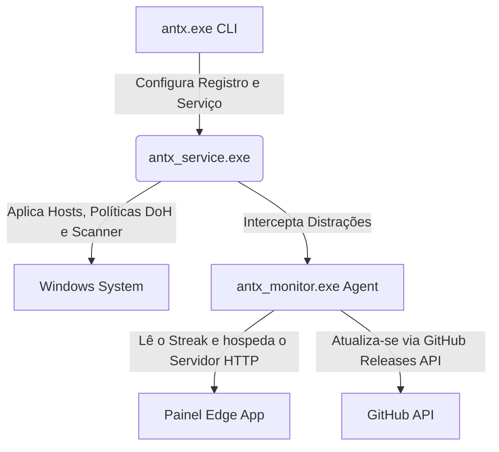

# 🛡️ Antx Blocker

*[Read this in English](README.md)*

[](https://github.com/bielsk1/antx/releases)
[](https://github.com/bielsk1/antx)
[](https://github.com/bielsk1/antx)
[](https://github.com/bielsk1/antx/blob/main/LICENSE)

Antx é um escudo de foco e bloqueador de procrastinação nativo em C++, ultrarresiliente e de alta performance, feito para o Windows. Construído para eliminar a distração pela raiz, ele impede ativamente a autossabotagem combinando serviços locais de baixo nível (kernel-like), bloqueio de DNS nos navegadores e um painel de vitória minimalista, livre de estímulos de dopamina.

Diferente de extensões de navegador simples que podem ser desativadas com dois cliques, **o Antx foi projetado para ser praticamente impossível de burlar** sem que você digite a senha extrema que configurou para si mesmo.

---

## 🌟 Principais Recursos

*   **🛡️ Autodefesa Ativa (Tamper Proofing):** Utiliza um Serviço Nativo do Windows (`antx_service.exe`) rodando na conta `LocalSystem` com mecanismos agressivos de autorrecuperação.
*   **🚫 Scanner Nativo de Processos:** Analisa ativamente as janelas dos processos a cada 400ms. Encerra instantaneamente navegadores (Chrome, Edge, Firefox, Opera, Brave, Vivaldi) que tentarem acessar as palavras-chave bloqueadas.
*   **🔒 Bloqueio de Desinstalação:** Impede a desinstalação ou parada manual do serviço. Parar o bloqueador exige uma senha criptografada com hash SHA-256 armazenado com segurança no Registro do Windows.
*   **⚙️ Bloqueio de DNS-over-HTTPS (DoH):** Altera os registros do Windows e as políticas dos navegadores para forçar a desativação do DoH, garantindo que o arquivo `hosts` local seja estritamente respeitado.
*   **📊 Painel de Vitória Minimalista:** Uma interface premium em *dark-mode glassmorphic*, construída com Tailwind CSS. Mostra exclusivamente o seu Tempo de Foco Contínuo (Dias, Horas, Minutos e Segundos) e a contagem de tentativas bloqueadas. Sem menus distrativos.
*   **🔄 Auto-Updater Silencioso:** Um agente em segundo plano checa a API do GitHub a cada 12 horas. Se uma nova versão for publicada, ele faz o download e atualiza o sistema silenciosamente, sem interromper você.

---

## 🏗️ Arquitetura: O Escudo em 3 Partes

O Antx é dividido em três componentes altamente especializados que se comunicam perfeitamente:



1.  **`antx.exe` (Controlador CLI):** A ferramenta de linha de comando usada para instalar, configurar senhas no registro, gerar chaves de alta segurança antissabotagem ou desinstalar o sistema de forma segura.
2.  **`antx_service.exe` (O Guardião):** Um Serviço do Windows em segundo plano que monitora constantemente a integridade do arquivo `hosts`, sobrepõe os protocolos DoH do sistema e atua como o scanner de baixo nível que encerra janelas proibidas.
3.  **`antx_monitor.exe` (Painel & Agente de Update):** Um agente super leve que roda na bandeja do sistema (perto do relógio). Ele hospeda um pequeno servidor HTTP local em Winsock para exibir o seu Painel de Foco e gerenciar as atualizações silenciosas automáticas.

---

## 🚀 Como Começar e Instalar

### Opção 1: Instalação Rápida (Recomendado)
Acesse a página de [Releases](https://github.com/bielsk1/antx/releases), baixe a última versão do instalador `Antx_Setup.exe` e execute. O instalador vai extrair todas as dependências, criar os atalhos e iniciar a proteção automaticamente no seu PC.

### Opção 2: Compilação Estática (Do Código-Fonte)
Se você prefere compilar os binários com suas próprias mãos, garanta que você tem o **GCC/MinGW** instalado e no PATH do Windows.

1.  **Clone o repositório:**
    ```bash
    git clone https://github.com/bielsk1/antx.git
    cd antx
    ```

2.  **Compile os componentes estaticamente:**
    ```powershell
    # Compilar o Controlador CLI
    g++ -std=c++17 -O3 -static -static-libgcc -static-libstdc++ src/cli/main.cpp -o build/bin/antx.exe -Isrc/common -lbcrypt -ladvapi32 -lshell32

    # Compilar o Serviço Guardião
    g++ -std=c++17 -O3 -static -static-libgcc -static-libstdc++ src/service/service.cpp -o build/bin/antx_service.exe -Isrc/common -ladvapi32

    # Compilar o Monitor e Atualizador UI
    g++ -std=c++17 -O3 -static -static-libgcc -static-libstdc++ src/monitor/monitor.cpp src/monitor/updater.cpp -o build/bin/antx_monitor.exe -Isrc/common -lws2_32 -luser32 -ladvapi32 -lpsapi -lshell32 -lwininet -mwindows
    ```

3.  **Execute a Instalação como Administrador:**
    Abra o PowerShell como **Administrador** dentro da pasta `build/bin/` e rode:
    ```powershell
    .\antx.exe install
    ```
    Para trancar a proteção com uma senha e evitar autossabotagem:
    ```powershell
    .\antx.exe set-password
    ```

---

## 🤖 Entrega Contínua CI/CD (GitHub Actions)

Este repositório já inclui um fluxo de lançamento automatizado no arquivo `.github/workflows/release.yml`. 

Quando você empurra (push) uma nova versão para o GitHub:
```bash
git tag v1.0.0
git push --tags
```
O GitHub Actions liga um servidor Windows na nuvem, instala o MSYS2/MinGW, compila os três arquivos C++ estaticamente, invoca o **Inno Setup compiler** (através do arquivo `installer.iss`), empacota tudo e hospeda publicamente na página de Releases para os seus usuários.

---

## 📄 Licença
Este projeto está sob a licença MIT. Veja o arquivo [LICENSE](LICENSE) para mais detalhes.
